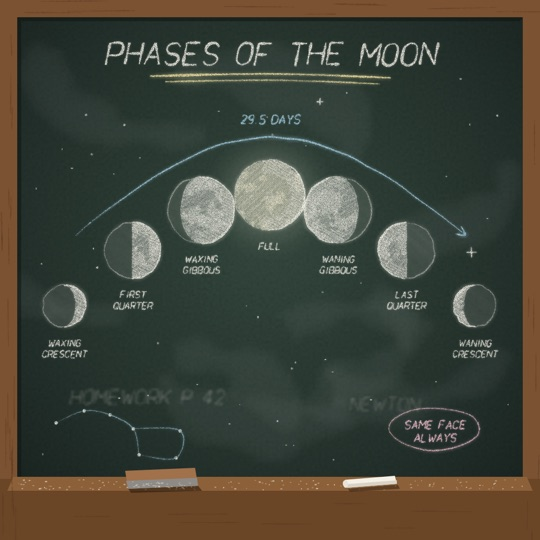
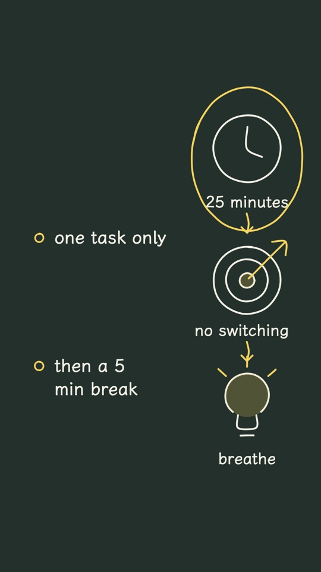
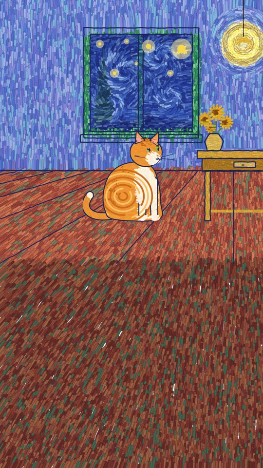
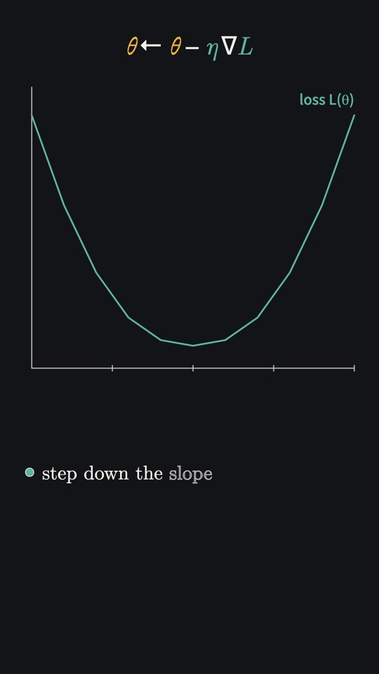
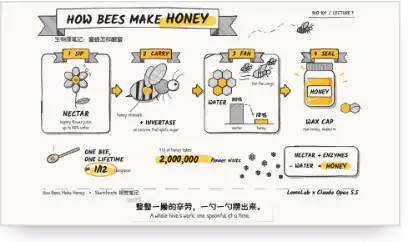

# Hand-drawn style (choose a category)

Seven hand-drawn or explainer looks, each built with an outside repo. **Never a default.** Warm & witty stays the default for shorts, Golden Vlog for vlogs and Screen Share for long form.

## How to use this skill

1. Read the brief and pick **2–3 categories that fit** from the table below. Show them to Harnoor as options, each with its one-line look and its sample frame (`styles/screenshots/hand-drawn/`). Let him pick.
2. If he doesn't pick, choose the best fit, say which one and why in one line, and go on.
3. **Install the tool only after a category is picked.** Never install all five up front.
4. Use one category for the whole piece unless he asks to mix them. The usual mix is a talking head in the house style with 1–3 hand-drawn beats.
5. Prove the look on one still before rendering the clips.

| # | Category | Look, in one line | Use it when | Tool | Sample |
|---|---|---|---|---|---|
| 1 | **Draw-on doodle** | An illustration draws itself mark by mark (pencil, wash, ink, crayon, woodcut) and ends on the finished still | An object or idea should appear as he names it; small stickers in the chest band; "how it's made" timelapses | anidoodle |  |
| 2 | **Chalkboard and blueprint** | Chalk on slate, or ruling-pen lines on a cyanotype sheet, with labelled diagrams | Teaching beats, "how it works", system or hardware diagrams | anidoodle (`chalkboard`, `cyanotype blueprint` styles) |  |
| 3 | **Whiteboard explainer** | A pen tip draws icons and short points one cue at a time on a dark or light board | A list or process told step by step (3–6 cues), timed to his words | huashu-art-motion (`y3_whiteboard` grammar) |  |
| 4 | **Painterly motion** | A painting that keeps moving: Van Gogh strokes, Seurat dots, Matisse cut paper, ink wash | Art, history or "through the ages" beats; an era-changing transition | huashu-art-motion (style recipes) |  |
| 5 | **Vox collage** | Torn paper cut-outs, halftone, tape, newspaper clippings and bold flat colour | Story or history explainers, "how X conquered the world" topics | vox-director (whole AI-made film) or huashu `y2_vox` grammar (code-drawn clips) |  |
| 6 | **Maths and diagram morphs** | Precise vector shapes on dark ground: graphs draw on, equations build, one shape turns into the next | Numbers, formulas, graphs, algorithms, "why this works" | 3b1b/manim (ManimGL); huashu `t1_3b1b` grammar for quick clips |  |
| 7 | **Whole-film looks** | One complete film look out of 59, such as sketchnote, marker paper, ink wash or watercolour | A whole piece in one look, usually faceless or a long-form segment | lemo-opuscar |  |

Quick picks: an "explain this idea" short → 1, 3 or 6. A history or story short → 4 or 5. A "make the whole thing hand drawn" request → 7, then 1.

## The tools

### anidoodle (categories 1 and 2)
Full house rules, install and render steps: [anidoodle-style](../anidoodle-style/SKILL.md). Apache-2.0, © 2026 Alex Greenshpun. Install: `/plugin marketplace add alexgreensh/anidoodle` then `/plugin install anidoodle@alexgreensh-anidoodle`. Render at `--format 9x16`, 30 fps. Convert VP9 WebM alpha to ProRes 4444 before it goes into FCP.

### huashu-art-motion (categories 3, 4, 5 and 6)
Full house rules: [huashu-art-motion-style](../huashu-art-motion-style/SKILL.md). MIT, © 2026 alchaincyf. Install: `npx skills add alchaincyf/huashu-art-motion`. Grammar clips come from a JSON cue spec: `render.py --spec clip.json --alpha --fps 30 --out clip.mov`. **Its example specs are in Chinese, so rewrite every cue text in English** and set `width`/`height` to 1080×1920 for reels. The whiteboard and maths samples here were made this way (Nov 25, 2026).

### vox-director (category 5)
[Alisa0808/vox-director](https://github.com/Alisa0808/vox-director), MIT, © 2026 Alisa Qian. It turns one topic into a whole paper-collage film. The pipeline goes from a beat map to a style bake-off, then generated collage posters, image-to-video motion, TTS plus music, and ffmpeg assembly, all on the Atlas Cloud API.
- Install: `git clone https://github.com/Alisa0808/vox-director.git ~/.claude/skills/vox-director`, then `export ATLASCLOUD_API_KEY=…`. It needs ffmpeg and Pillow.
- **It spends credits**, so ask before every run and show the beat map first. Its A-roll mode restyles his own talking head and its Host mode makes a lip-synced presenter. Both use his likeness, so ask first.
- Its images are AI-generated, which works against the "shouldn't look AI-made" rule. Prefer its local element engine (`extract_elements.py`, which cuts a poster into pieces and animates them in code) or the huashu `y2_vox` grammar. Use the generated posters only for idea beats, never for proof.
- Turn off its burned-in captions, watermark, narrator and music. Captions, voice and sound come from Harnoor's edit.
- Don't put Vox's name or logo on screen. "Vox style" is only how we describe the look.

### 3b1b/manim (category 6)
[3b1b/manim](https://github.com/3b1b/manim) (ManimGL), MIT, © 2020–2026 3Blue1Brown LLC. It's an engine for precise programmatic maths animation.
- Install: `pip install manimgl`, with Python 3.10+, FFmpeg and OpenGL, plus LaTeX (optional) for `Tex`. On Python 3.12, `pkg_resources` must be present (`setuptools<70`).
- Render: `manimgl scene.py MyScene -w -t -r 1080x1920 --fps 30`. Here `-w` writes the file and `-t` gives a transparent `.mov`, which goes on its own lane.
- Its install steps are not the same as the community edition's (ManimCommunity/manim). Don't mix them.
- The separate [3b1b/videos](https://github.com/3b1b/videos) repo (his own scenes and the Pi creature character) is **not** MIT. Don't copy its code, characters or branding.
- A headless `-s` still did not finish on this Mac (Nov 25, 2026; it likely waited on an OpenGL window). Test-render once with `-w` before planning around it, and fall back to the huashu `t1_3b1b` grammar if it doesn't work.

### lemo-opuscar (category 7)
This stays as its CLAUDE.md bullet: [lemomo-ai/lemo-opuscar](https://github.com/lemomo-ai/lemo-opuscar), [gallery](https://lemomo-ai.github.io/lemo-opuscar/). Install it only once he picks a look: `claude plugin marketplace add lemomo-ai/lemo-opuscar`, then `claude plugin install lemo-opuscar@lemolab`.
- Its code is MIT. Its demo films, posters and stills are CC BY 4.0, so credit "Lemo-Opuscar by Lemomo (LemoLab)" with links to the repo and licence. Its docs and prompts are CC BY-NC 4.0, with extra permission for your own films, client films included.
- Clawd, the Claude app interface and six TTS voice tracks are excluded from its licences.

## Harnoor's rules on top (every category)

- **Not AI-made:** code-drawn marks over generated images. Use his real words, numbers and examples. No generic stock subjects, no glossy AI gradients and no AI-looking faces. Real pages, posts and products always get the real capture, never a drawing of them.
- **Fonts:** any lettering uses this repo's pairings (`fonts/`, README pairings) or the active caption font, not the tool's default.
- **Safe zones (9:16):** keep anything to be read out of the face area (y 460–1060). Put it in the top band (y 80–430) or the chest band (y 1110–1580). Full-screen boards with no face can use the whole frame, with platform UI margins. About 6 words per board besides numbers.
- **No text over the face.** A drawing may sit beside or below the head, but words never cross the eyes or mouth.
- **Captions** stay the active style's captions (warm & witty by default), above the head, on their own lane. Never bake them into a drawing. Long form has no captions.
- **Layering:** every clip is its own alpha ProRes 4444 `.mov` on a named FCPXML lane (for example "Doodle – chalkboard" or "Manim – graph"), separate from Title, captions and other graphics. Snap offsets and starts to the 1/30 s grid.
- **Timing:** the last mark lands on the payoff word, and the finished drawing holds 1.5 s. Entrances settle within 10 frames, and one thing moves at a time.
- **Sound:** the tools' own scores, voices and SFX stay off unless he asks. The active style's music bed and Ocular SFX rules apply.
- **Credit and copying:** in `project.md`, name the tool and its licence for every clip, and list what changed from its demos. Never recreate a show, studio or franchise look, and never copy a reference's lines.
- **Delivery:** alpha clips plus the FCPXML, LUT, SRT and preview, in the project's `renders/` and `~/Movies/FCP/<name>-graphics/`.

## Sample frames (Nov 25, 2026)

- `draw-on-doodle.jpg` and `hand-drawn.jpg`: anidoodle `wrenDraw`, frame 200 mid-draw, rendered with its `still.mjs` (Apache-2.0, © 2026 Alex Greenshpun).
- `chalkboard.jpg`: anidoodle `moonPhases`, rendered with `still.mjs` (Apache-2.0).
- `whiteboard.jpg` and `math-morph.jpg`: huashu-art-motion `y3_whiteboard` and `t1_3b1b` grammars at 1080×1920, with English cue text, rendered with its `render.py` (MIT). The maths frame is huashu's 3b1b-style grammar, not a manim render.
- `huashu-art-motion-9x16.jpg`: the huashu Van Gogh scene (MIT).
- `vox-explainer.jpg`: a Vox Director Tang thumbnail from its repo (MIT, © 2026 Alisa Qian).
- `whole-film-lemo.jpg`: the lemo-opuscar Sketchnote poster, converted to JPEG. Lemo-Opuscar by Lemomo (LemoLab), [CC BY 4.0](https://creativecommons.org/licenses/by/4.0/).
